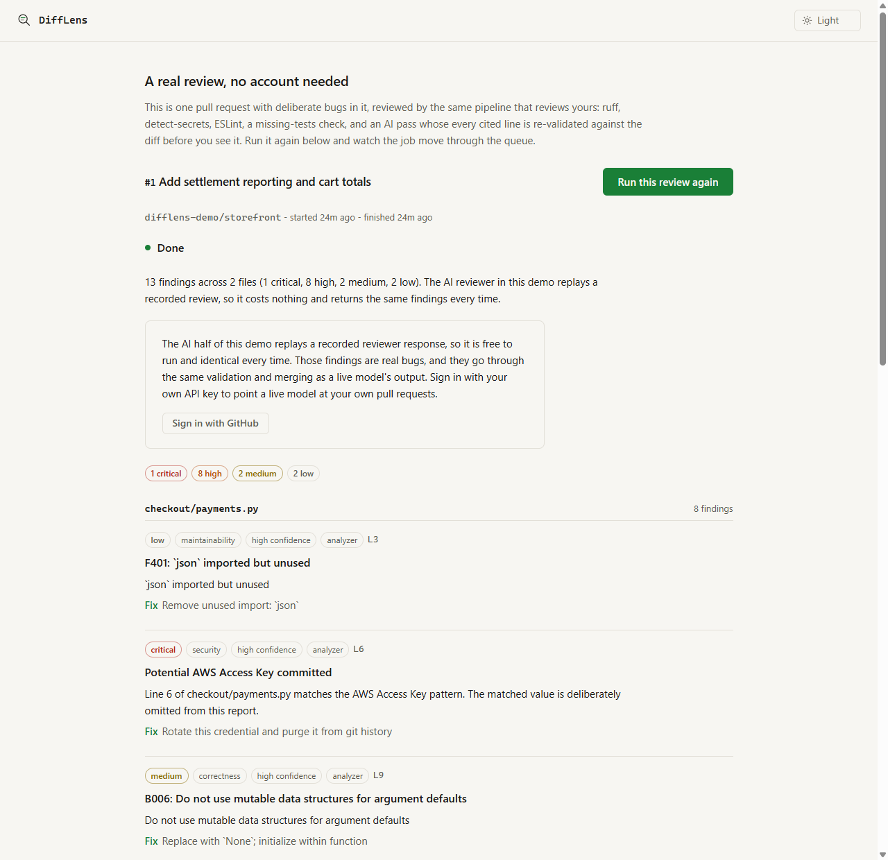
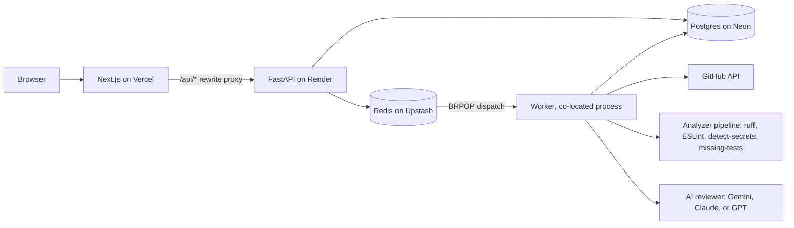

# DiffLens

[](https://github.com/AnirudIye/difflens/actions/workflows/ci.yml)

DiffLens is a code review platform for GitHub pull requests and whole repositories. It combines deterministic static analysis with an AI reviewer, then checks every file and line the AI cites against the exact commit under review. Findings that point at code that does not exist are discarded before anything is shown.

Sign in with GitHub, choose a pull request or a repository, and DiffLens fetches the diff or snapshot, runs the analyzers and the AI reviewer, deduplicates the results, and presents each finding with a severity, category, confidence level, and concrete recommendation.

**[Try the live demo](https://difflens-zeta.vercel.app/demo).** It shows one pull request containing deliberate bugs, reviewed by the real pipeline. No account or API key is needed. Hosting is on a free tier, so the first request after a quiet period can take up to a minute.

<picture>
  <source media="(prefers-color-scheme: dark)" srcset="docs/images/demo-review-dark.png">
  
</picture>

*The public demo at `/demo`. Every finding is pinned to a file and a line, and carries the analyzer or model it came from.*

## Features

- Reviews pull requests and entire repositories. Each review is pinned to immutable commit SHAs (base and head for a pull request, the default branch head for a repository), so the findings describe one exact snapshot even if the branch moves afterward.
- Runs deterministic analyzers: ruff for Python, ESLint for TypeScript and JavaScript, detect-secrets for leaked credentials, and a missing-tests heuristic for pull requests. Ruff uses the reviewed repository's own configuration when one exists at the repository root, and DiffLens's default rule set otherwise; the review summary states which was used. ESLint always runs with a bundled configuration, because an ESLint flat config is executable JavaScript and honoring it would mean running the reviewed repository's code.
- Runs an AI reviewer behind a provider abstraction that supports Gemini, Anthropic, and OpenAI, plus a mock provider that needs no API key, so the full pipeline works locally and in CI. Gemini is the provider used in production and the only one verified against a live API. The Anthropic and OpenAI providers are covered by tests against recorded responses.
- Validates every AI-cited file and line against the reviewed snapshot and discards locations that do not exist. Reviewed content is treated as untrusted input to the model, and prompt-injection defense is part of the pipeline design.
- Ingests repository tarballs under hard limits (20,000 files, 200 MB extracted) and rejects an oversized repository instead of reviewing a truncated tree. The AI reads the tree in chunks, up to 40 with a user-supplied API key and one without, and each review reports how many files the AI covered.
- Deduplicates findings across analyzers and the AI using content-based fingerprints. Each finding is stored with its severity, category, confidence, source, and recommendation, and can be marked helpful or wrong.
- Authenticates with GitHub OAuth using an empty scope. DiffLens has read-only access to public repositories and never requests write access.
- Serves a public demo at `/demo` that anyone can read and re-run without an account. It goes through the same queue, worker, analyzers, and validation chain as any other review. Only the diff source and the AI response are bundled, so a run costs nothing.

## Architecture



The frontend is a Next.js 15 application on Vercel. It proxies `/api/*` to a FastAPI service on Render, so the browser only ever talks to one origin. The API and a supervised worker process run in the same container. Postgres on Neon is the source of truth for job state, and Redis on Upstash only signals the worker that a job is waiting. The whole stack runs on free tiers.

## Design decisions

Significant decisions are recorded as architecture decision records (ADRs). Each one describes the alternatives that were considered and the trade-offs that were accepted.

| ADR | Decision | Summary |
|---|---|---|
| [0001](docs/adr/0001-queue-redis-dispatch-postgres-truth.md) | Redis dispatches, Postgres is the source of truth | Why the queue is hand-rolled instead of built on Celery, and the free-tier command budget that decided it. |
| [0002](docs/adr/0002-github-oauth-empty-scope.md) | GitHub OAuth with an empty scope | Why a review tool should not be able to write to your repository. |
| [0003](docs/adr/0003-session-via-next-rewrite-proxy.md) | One origin for the browser | The rewrite proxy, and the third-party cookie problem it avoids. |
| [0004](docs/adr/0004-provider-abstraction-and-output-validation.md) | AI provider and output are untrusted | The provider abstraction and the validation chain that discards hallucinated locations. |
| [0005](docs/adr/0005-repository-snapshot-reviews.md) | Repository snapshots are a review target | The target union, the tarball limits that refuse rather than truncate, and the chunked AI tiers that keep a repository review from exhausting the shared key. |
| [0006](docs/adr/0006-snapshot-precision.md) | Snapshot precision is a filter problem | Why reviewing a whole repository made the deterministic analyzers noisy, and what replaced the filtering a diff used to provide. |

## Local development

Prerequisites: Docker Desktop, Node 20+, and [uv](https://docs.astral.sh/uv/).

1. Copy the environment template and fill in what you need. Mock AI mode needs no keys.

   ```bash
   cp .env.example .env
   ```

2. Start Postgres and Redis.

   ```bash
   docker compose up -d
   ```

3. Run the API.

   ```bash
   cd api
   uv sync
   uv run uvicorn app.main:app --reload
   ```

4. In a second terminal, run the frontend.

   ```bash
   cd web
   npm install
   npm run dev
   ```

5. In a third terminal, run the worker. Without it, reviews are queued but never start.

   ```bash
   cd api
   uv run python -m worker
   ```

On Windows, `run-api.cmd`, `run-worker.cmd`, and `run-web.cmd` at the repository root launch each process in its own window. They use the virtual environment at `api\.venv`, so run `uv sync` once first.

To run the demo locally, set `DEMO_MODE=1` in `.env`, seed it once with `uv run python -m app.demo.seed` from `api/`, and open http://localhost:3000/demo.

The databases run in Docker while the API and web app run natively for fast reloads. Postgres is published on host port 55432 rather than 5432, so it does not collide with a locally installed PostgreSQL. To build and run the API in a container as well, use `docker compose --profile full up -d`.

## Security

The threat model, including the risks that are accepted rather than mitigated, is documented in [docs/THREAT_MODEL.md](docs/THREAT_MODEL.md). The central assumption is that reviewed content is untrusted input, and most of the design follows from it.

## Deployment

Production runs on free tiers: Vercel for the frontend, Render for the API (Docker, configured by `render.yaml` at the repository root), Neon for Postgres, and Upstash for Redis. The full runbook, including the environment variable table and the deploy order that resolves the OAuth callback circular dependency, is in [docs/DEPLOYMENT.md](docs/DEPLOYMENT.md).

## License

MIT. See [LICENSE](LICENSE).
